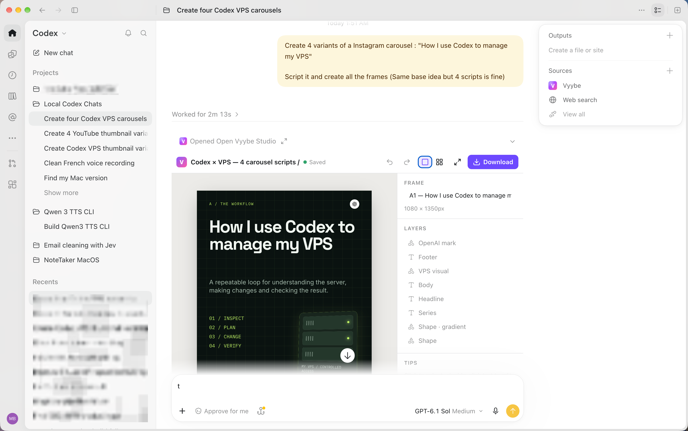
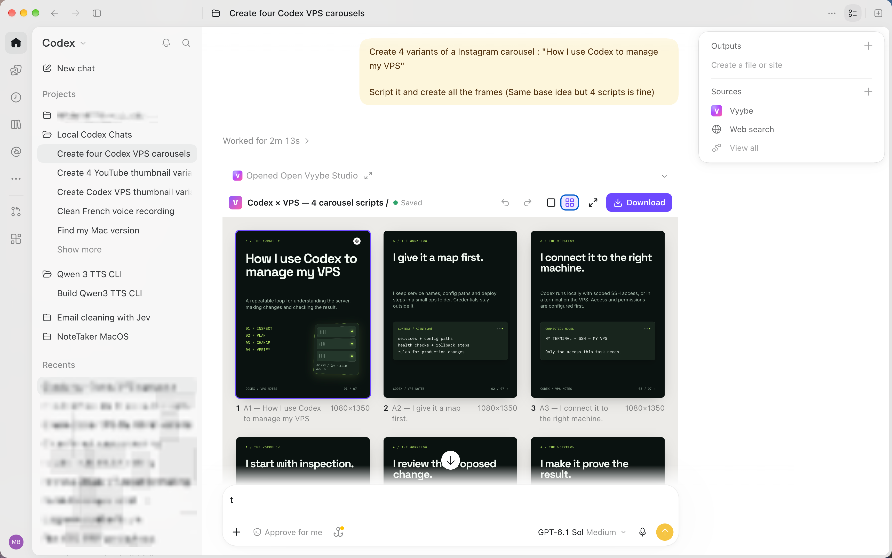

# Vyybe

**On-brand marketing visuals, made in chat.** Vyybe is a plugin for **Claude Code** and **Codex** that turns your coding agent into a designer: Instagram & LinkedIn carousels, posts, stories, YouTube thumbnails, ad creatives, banners and slides — rendered at exact sizes, editable right in the chat, downloadable as PNG / JPG / PDF / ZIP.




- **Simple prompts in, finished visuals out.** "Make a 6-slide carousel about how I use Codex to manage my VPS" is enough. The agent asks a question only when it really matters.
- **Your branding, remembered.** Save colors, fonts, logo, art direction and tone once; every creation stays consistent.
- **Pick visually.** When you want to choose a direction, Vyybe shows a gallery of live style previews in the chat.
- **Edit without spending tokens.** The in-chat studio lets you change text, colors, fonts, positions and sizes, reorder slides and download — no prompt needed.
- **Local-first.** Projects and brandings live in `~/Vyybe` on your computer. No account. Optional image generation uses your own API key (OpenAI, Gemini, fal.ai or Replicate) — or Codex's built-in image generation.

## Install

### Claude Code (desktop app or terminal)
```bash
claude plugin marketplace add <path-or-git-url-of-this-repo>
```
```bash
claude plugin install vyybe@vyybe
```
Or inside a session: `/plugin marketplace add …` then `/plugin install vyybe@vyybe`.

### Codex (desktop app or CLI)
```bash
codex plugin marketplace add <path-or-git-url-of-this-repo>
```
```bash
codex plugin add vyybe@vyybe
```
Restart the app after installing.

### Requirements
- macOS (Windows/Linux: experimental).
- A Chrome-based browser installed (Chrome, Edge, Brave…) — or let Vyybe download a private headless Chrome (~90 MB) on first use.
- Node.js 22+ is used if present; otherwise Vyybe downloads a private, checksum-verified Node runtime into `~/Vyybe/.vyybe/runtime` the first time it starts.

## Use it
Just ask:
- "Make a 6-slide Instagram carousel about how I plan my week with AI."
- "3 YouTube thumbnail options for my video *I quit my job to build in public*."
- "Turn this article into a LinkedIn carousel: <link>"
- "Set up my branding from my website."
- "Show me a few styles for a launch announcement."
- "Make slide 3 punchier." / "Now a story version." / "Export it as PDF."

Skills included: `vyybe-create`, `vyybe-edit`, `vyybe-branding`, `vyybe-setup`.

## Where things live
```
~/Vyybe/
  Projects/<project>/        project.json, frames/*.html, assets/, exports/, .history/
  Brandings/<branding>/      branding.json, assets/ (logos)
  .vyybe/                    config, cache (fonts), private runtimes
```
API keys are stored in the macOS Keychain (service "vyybe"), or in `~/Vyybe/.vyybe/credentials.json` (mode 600) on other systems. Environment variables (`OPENAI_API_KEY`, `GEMINI_API_KEY`, `FAL_KEY`, `REPLICATE_API_TOKEN`, `PEXELS_API_KEY`, `UNSPLASH_ACCESS_KEY`) also work.

## How it works
- **Frames are HTML + Tailwind fragments** written by the agent into a fixed-size canvas. Vyybe owns the scaffold: theme tokens (`bg-primary`, `font-display`), fonts (Google Fonts, cached locally), components (`<vy-icon>`, `<vy-logo>`, `<vy-page>`), pinned Tailwind v4, rendering, checks and export.
- **Rendering** uses headless Chrome over the DevTools protocol, offline and script-free. Every write returns a preview image and automatic layout checks (overflow, clipped/overlapping text, contrast, tiny text, safe zones, missing fonts/images).
- **The studio** is an MCP App (rendered inline in hosts that support MCP Apps) with a local browser fallback. Edits are saved straight back into the frame HTML, with revision history.

See [docs/architecture.md](docs/architecture.md) and [docs/development.md](docs/development.md).
